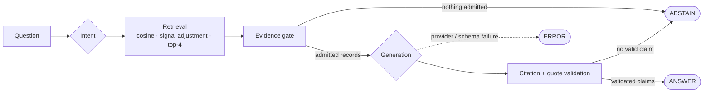
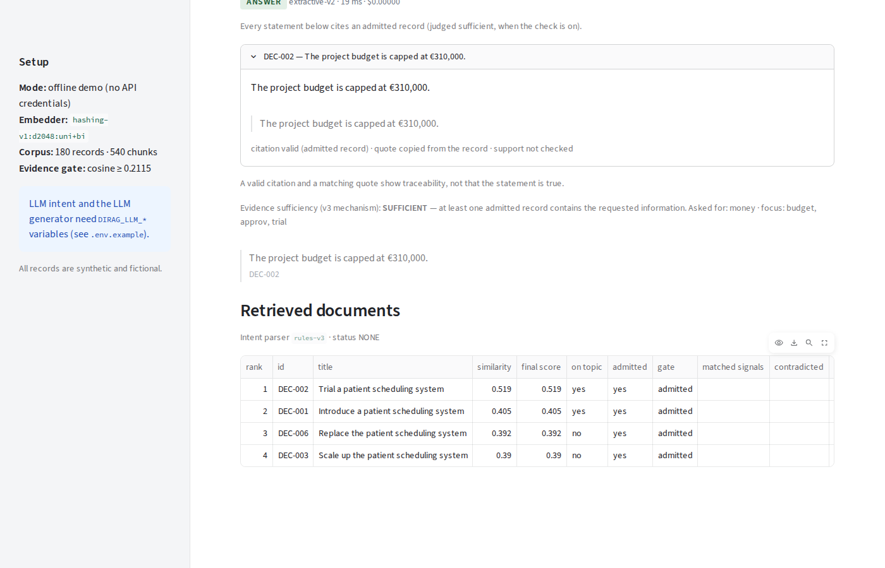
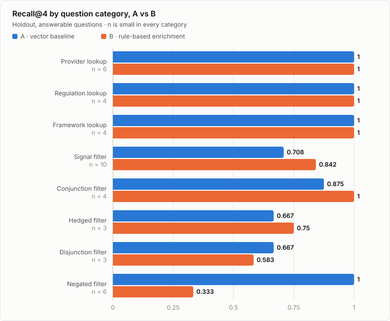

# Decision Intelligence RAG

*Evidence-grounded retrieval, answer generation, and reproducible RAG evaluation.*

[](https://github.com/LorenzoNMachado/decision-intelligence-rag/actions/workflows/tests.yml)
[](pyproject.toml)
[](LICENSE)

## Project overview

Decision Intelligence RAG is a research testbed for retrieval-augmented generation over organisational decision records. You can try different retrieval and generation mechanisms on a synthetic corpus and measure how each one affects retrieval quality, answer correctness, citation grounding and abstention. The mechanisms are a vector baseline, a rule-based semantic layer, an optional LLM intent parser, an extractive generator and an optional LLM generator.

It is **a research implementation, not a production system**. It runs fully offline, needs no API key, and every reported number comes from a frozen, verifiable protocol.


> **Status.** Protocol **v2** is frozen, and its holdout was run once for the two offline configurations (A, B). Those results are **exploratory**: the system never saw the holdout before the freeze, but the same author wrote the system, the corpus and the questions. The four configurations that need an LLM (C–F) are implemented and tested with scripted models, but **have not been executed**. No LLM result is reported anywhere.

## Research problem

Questions about decisions are often constraints rather than topics: *"which decisions about the payroll system depend on an outside firm?"* or *"…explicitly have no legal basis?"*. Vector similarity finds records about the right subject, but it cannot tell whether a record satisfies, contradicts or ignores the constraint. A generator may then cite irrelevant records, or answer questions that the records cannot answer. The project asks:

1. **RQ1.** Does a semantic-signal layer (rule-based or LLM-based question interpretation) improve retrieval over a pure vector baseline?
2. **RQ2.** How much of answer quality comes from the generator rather than the retriever?
3. **RQ3.** How well do an evidence gate and citation validation prevent answers to unanswerable questions?

## Key features

- **Three retrieval strategies behind one ranker.** A vector baseline, a rule-based semantic layer (local negation scope, coordination, hedging, entity masking), and LLM intent with deterministic validation.
- **Evidence gate and grounding.** Only admitted records reach the generator. An answer is composed only of claims whose citations are admitted records and whose quotes occur verbatim in the record body.
- **Explicit answer states.** ANSWER, ABSTAIN and ERROR. Provider failures are never counted as abstentions, and an abstention is never graded as correct.
- **Reproducible evaluation.**
  - A dev/holdout split, with calibration on dev only.
  - A frozen manifest that hashes data, prompts, parameters, code, the dependency lock and provider identity.
  - Per-question paired sign tests.
  - Runs that refuse to overwrite results.
- **Fail-closed cost control** for optional providers. The client refuses a request whose worst-case cost cannot be bounded.
- **Fully offline by default.** A deterministic feature-hashing embedder, a synthetic corpus and no network calls.

## Architecture



Strategy 3 intent and the LLM generator are optional stages that need a provider. The full diagram, separating the offline and LLM paths, is in [`docs/architecture.md`](docs/architecture.md).

## Quick start

Requires Python 3.12 or 3.13 and [uv](https://docs.astral.sh/uv/). No API key, account, database or model download is needed.

```bash
git clone https://github.com/LorenzoNMachado/decision-intelligence-rag.git
cd decision-intelligence-rag
uv sync --locked --extra app            # add --python 3.13 to use Python 3.13

uv run dirag corpus-validate            # the synthetic corpus is committed; this checks it
uv run dirag ask "Which decisions about the feature flag service have security dependencies?" --retrieval rules
uv run streamlit run app/streamlit_app.py   # http://localhost:8501

uv run pytest                           # test suite (offline, providers mocked)
uv run dirag verify-manifest            # protocol v2 unchanged since its freeze
uv run dirag verify-v1                  # historical protocol v1 artefacts intact
```

`make help` lists the same commands as short targets (`make install`, `make ask`, `make app`, `make check`).

`dirag ask` prints a JSON record with the parsed intent, the ranked records with their gate decisions, and the answer with its claims. Two behaviours worth trying:

```text
$ uv run dirag ask "Which catering company was selected for the staff cafeteria contract?"
→ "status": "ABSTAIN", "abstain_reason": "no document passed the evidence gate"

$ uv run dirag ask "What budget was approved for the decision to adopt a customer data warehouse?"
→ "status": "ANSWER"   (a known limitation: no record states a budget, but the question names a real record)
```

## Interactive demo

The Streamlit app (`uv run streamlit run app/streamlit_app.py`) runs offline. LLM options appear only when provider variables are set. All screenshots below were captured from the real app in offline mode (`scripts/capture_screenshots.py`).

**Retrieval and evidence.** Every claim shows its citation, quote and support status. The ranked records show their similarity, adjusted score, gate decision and matched signals.



**Measured results.** Results are shown per protocol, with the paired sign test and a note that the LLM configurations have not been executed.


## Experimental configurations

| ID | Retrieval | Generator | Needs a provider | Status |
|---|---|---|---|---|
| A | Vector baseline | Extractive | no | measured |
| B | Rule-based semantic enrichment | Extractive | no | measured |
| C | Vector baseline | LLM | yes | **not executed** |
| D | Rule-based semantic enrichment | LLM | yes | **not executed** |
| E | LLM semantic intent | LLM | yes | **not executed** |
| F | LLM semantic intent | Extractive | yes | **not executed** |

**Protocol v2 data.**
- A corpus of 180 synthetic decision records (540 chunks).
- 70 hand-written questions in ten categories: lookups; signal, negated, conjunction, disjunction and hedged filters; and unanswerable questions inside and outside the domain.
- A proportional split of 20 dev and 50 holdout questions.

**Optional LLM providers.** Any OpenAI-compatible endpoint can be configured through environment variables (see [`.env.example`](.env.example)). Token prices are required whenever a spending limit is set. Before each request the client computes an upper bound of its cost and refuses requests that might exceed the limit, or whose cost cannot be bounded. The limit is only as accurate as the configured prices; the provider's billing is authoritative. Details: [`docs/methodology.md`](docs/methodology.md).

## Measured results

Protocol v2 holdout: 50 questions (40 answerable, 10 unanswerable). Offline `hashing-v1` embedder, extractive generator, one deterministic run per configuration. Source: [`experiments/v2/results/holdout-ab/`](experiments/v2/results/holdout-ab/summary.md).

| Metric | Vector baseline (A) | Rule-based (B) |
|---|---:|---:|
| Recall@4 (n = 40) | 0.865 | 0.810 |
| Supporting-source precision (n = 40) | 0.369 | 0.381 |
| Strict correctness (n = 40) | 0.050 | 0.100 |
| Partial correctness (n = 40) | 0.675 | 0.525 |
| Correct abstention, in-domain unanswerable | 0/6 | 0/6 |
| Correct abstention, out-of-domain unanswerable | 3/4 | 3/4 |
| Recall@4 per question, A → B | — | 6 better, 5 worse, 29 tied; sign test **p = 1.0** |





**How to read these numbers:**

- These are **exploratory** results on a **synthetic** corpus.
- The rule-based strategy shows **no statistically demonstrated advantage**. It helps positive signal filters (0.708 → 0.842) and fails on negated filters (1.000 → 0.333). The per-question sign test on Recall@4 gives p = 1.0.
- The generator is **extractive**: it quotes one sentence from every admitted record, so strict correctness is low by construction.
- Correctness comes from a **lexical key-fact judge**, which is an approximation that does not recognise paraphrases.
- **In-domain unanswerable questions remain a limitation.** Neither configuration abstained on any of them.
- Configurations with a real LLM (C–F) **have not been executed**.

The full interpretation, including where the rules helped and why, is in [`docs/results.md`](docs/results.md). An earlier protocol of this repository (v1) is kept as a historical record in [`experiments/v1/`](experiments/v1/README.md). Its numbers are not comparable with v2 and are superseded.

## Reproducibility

- **Data.** `uv run dirag corpus-generate --out /tmp/regen` regenerates `data/v2` byte for byte; CI diffs it on every pull request.
- **Results.** `uv run dirag run --split holdout --configs A,B --name my-run` reproduces the committed holdout rows exactly, apart from latency. Runs never overwrite existing results.
- **Protocol.** `uv run dirag verify-manifest` checks that the data, prompts, parameters, code and `uv.lock` are those frozen before the holdout was run. `uv run dirag verify-v1` checks the historical protocol against its git commit.
- **Figures.** `uv run python scripts/make_figures.py` recomputes the figures from the result files; the test suite fails if they drift.
- **CI** (Python 3.12 and 3.13) runs lint, strict type checking, the tests, a package build, data regeneration and both protocol checks. A security workflow scans the full history for secrets (gitleaks) and audits the locked dependencies (pip-audit).

## Technical documentation

| Document | Contents |
|---|---|
| [`docs/architecture.md`](docs/architecture.md) | Components, data flow, offline vs LLM stages, design decisions |
| [`docs/methodology.md`](docs/methodology.md) | Research method, corpus and question design, strategies A–F, dev/holdout, freezing, statistical limits |
| [`docs/evaluation.md`](docs/evaluation.md) | Metric formulas and denominators, judges, what each grounding check does and does not show |
| [`docs/results.md`](docs/results.md) | Measured v2 results and their interpretation |
| [`docs/limitations.md`](docs/limitations.md) | Known failures and threats to validity |
| [`experiments/README.md`](experiments/README.md) | Execution status of every study, per protocol |

## Limitations

- **Synthetic data and one author.** The corpus, the questions and the system were written by the same author, and the references come from the generator's intended labels.
- **Small samples.** There are 3–10 holdout questions per category. Most differences are within chance.
- **A lexical offline embedder** and a **lexical correctness proxy**.
- **Weak negation handling.** Negated filters fail under the rule-based strategy.
- **No in-domain abstention.** The evidence gate cannot detect in-domain unanswerable questions.
- **No LLM results.**

See [`docs/limitations.md`](docs/limitations.md).

## Future work

- Run configurations C–F with a provider, following the documented order: dev run, provider freeze, holdout run, judge.
- Develop a new protocol on new dev data and a new holdout. Candidate changes:
  - restrict signal adjustments to a subject's similarity band;
  - stop a PRESENT mention from overriding an explicit ABSENT statement;
  - check that the evidence covers the question before answering.
- Evaluate a dense embedding model with its own calibration.
- Use independently written questions and human relevance labels.

## References

* Lewis, P. et al. (2020). Retrieval-Augmented Generation for Knowledge-Intensive NLP Tasks. *NeurIPS*.
* Karpukhin, V. et al. (2020). Dense Passage Retrieval for Open-Domain Question Answering. *EMNLP*.
* Peffers, K. et al. (2007). A Design Science Research Methodology for Information Systems Research. *Journal of Management Information Systems*, 24(3).
* Chapman, W. W. et al. (2001). A Simple Algorithm for Identifying Negated Findings and Diseases in Discharge Summaries. *Journal of Biomedical Informatics*, 34(5).
* Gao, T., Yen, H., Yu, J., Chen, D. (2023). Enabling Large Language Models to Generate Text with Citations. *EMNLP*.
* Rashkin, H. et al. (2023). Measuring Attribution in Natural Language Generation Models. *Computational Linguistics*, 49(4).
* Min, S. et al. (2023). FActScore: Fine-grained Atomic Evaluation of Factual Precision in Long Form Text Generation. *EMNLP*.
* Es, S., James, J., Espinosa-Anke, L., Schockaert, S. (2024). RAGAS: Automated Evaluation of Retrieval Augmented Generation. *EACL System Demonstrations*.
* Kamath, A., Jia, R., Liang, P. (2020). Selective Question Answering under Domain Shift. *ACL*.
* Zheng, L. et al. (2023). Judging LLM-as-a-Judge with MT-Bench and Chatbot Arena. *NeurIPS Datasets and Benchmarks*.
* Weinberger, K. et al. (2009). Feature Hashing for Large Scale Multitask Learning. *ICML*.
* Youden, W. J. (1950). Index for Rating Diagnostic Tests. *Cancer*, 3(1).

## License and author

Released under the [MIT License](LICENSE). Runtime dependencies use permissive licenses (BSD, MIT, Apache-2.0), except `certifi` (MPL-2.0, unmodified, a dependency of `httpx`).

**Lorenzo Nakayama Machado**, Pontifícia Universidade Católica do Paraná (PUCPR). This repository is an independent implementation of concepts studied during applied research in Computer Science. It does not reproduce, and makes no claims about, the results of that earlier study.

Contributions: see [`CONTRIBUTING.md`](CONTRIBUTING.md). Security reports: see [`SECURITY.md`](SECURITY.md).
