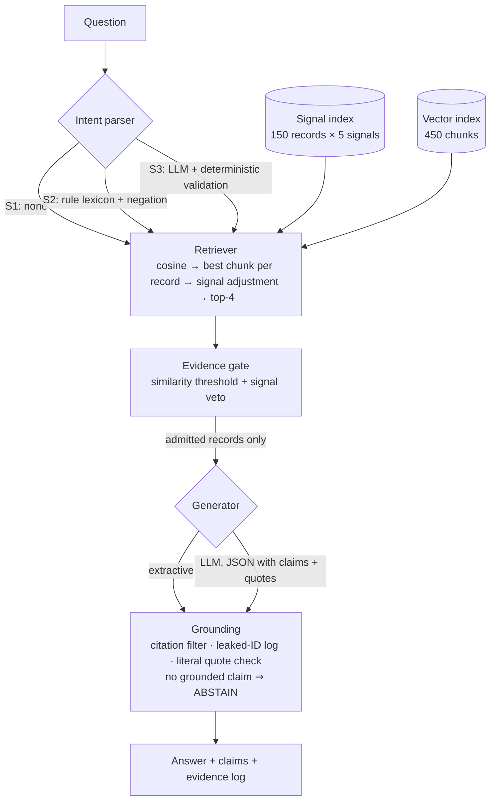

# Decision Intelligence RAG: Evidence-Grounded Retrieval and Answer Generation

An independent research implementation for evaluating evidence-grounded RAG architectures, semantic retrieval strategies, answer correctness, and citation faithfulness.

The project builds a complete, reproducible experimental platform around one question: when a retrieval-augmented system answers questions about organisational decisions, which components actually make the answers more correct and better grounded? Answers come from the retriever, from semantic interpretation of the question, or from the generator.

> **Status.** The offline part of the study (configurations A and B, the retrieval ablation, gate calibration and signal-classifier accuracy) has been executed under a frozen protocol, and its results are reported below. Configurations C–F use an LLM. They are implemented and tested with scripted models, but they have **not** been run against a real provider yet, so no LLM result is reported here.

## Problem

Organisations record decisions together with the reasons behind them: a vendor dependency, a legal obligation, a security requirement. Questions about those records are often constraints rather than topics. For example: *"which decisions about the payroll system depend on an external vendor?"* or *"…explicitly involve no legal requirement?"*. Vector similarity retrieves records about the right subject, but it is blind to whether a record satisfies, contradicts or ignores the constraint. A generator can then cite irrelevant records, or answer questions that the corpus cannot answer.

## Research questions

1. **RQ1.** Does a semantic-signal layer, using either rule-based or LLM-based question interpretation, improve retrieval over a pure vector baseline?
2. **RQ2.** How much of answer quality comes from the generator rather than from the retriever?
3. **RQ3.** How well do an evidence gate and citation validation prevent answers to unanswerable questions?

## Architecture



| Component | What it does |
|---|---|
| **Synthetic corpus** | 150 fictional decision records (10 domains), deterministic chunking into 450 chunks, integrity validation |
| **Embeddings** | Offline signed feature-hashing embedder (no credentials) and a cached OpenAI-compatible embedder |
| **Semantic signals** | Third-party dependency, operational motivation, legal dependency, security dependency and compliance relevance, each labelled PRESENT / ABSENT / UNCLEAR / ERROR by a rule-based classifier or an optional LLM classifier |
| **Retrieval** | Three strategies behind one ranker: vector baseline, rule-based enrichment and LLM semantic intent (REQUIRED / PREFERRED constraints, polarity, verbatim-evidence validation) |
| **Generation** | Deterministic extractive generator; LLM generator with versioned prompts, per-claim citations, verbatim quotes and explicit ABSTAIN |
| **Grounding** | Evidence gate, citation validation against admitted records, literal quote verification, and an *experimental* LLM claim verifier |
| **Evaluation** | Configurations A–F, eight metrics, lexical and LLM judges, ablation, dev-only calibration, frozen-manifest holdout lock |
| **Interface** | Streamlit app with ask, compare and corpus views; works fully offline |

Details: [`docs/architecture.md`](docs/architecture.md).

## Experimental design

| ID | Retrieval | Generator | Isolates |
|---|---|---|---|
| A | Vector baseline | Deterministic | baseline |
| B | Rule-based semantic enrichment | Deterministic | rule-based signals without an LLM |
| C | Vector baseline | LLM | the LLM generator |
| D | Rule-based semantic enrichment | LLM | rule-based signals with an LLM |
| E | LLM-based semantic intent | LLM | LLM intent with an LLM |
| F | LLM-based semantic intent | Deterministic | LLM intent without an LLM generator |

* **Questions.** There are 50 original questions: 40 answerable across six categories (lookups, signal filters, negated filters, multi-signal filters) and 10 unanswerable. They are split into 10 dev and 40 holdout questions, stratified.
* **Protocol.** Development and threshold calibration use the dev split only. `dirag freeze` then records SHA-256 hashes of data, prompts, parameters, configurations and source code, and the runner refuses the holdout split if anything has changed since. Each configuration runs three repetitions.
* **Metrics.** Recall@4, supporting-source precision, answer correctness, citation faithfulness, correct-abstention rate, false-answer rate on unanswerable questions, latency p50/p95 and cost per question. Operational failures (timeouts, network errors) are recorded separately.

Full protocol: [`docs/methodology.md`](docs/methodology.md). Metric definitions: [`docs/evaluation.md`](docs/evaluation.md).

## Installation

Requires Python 3.12+ and [uv](https://docs.astral.sh/uv/).

```bash
git clone https://github.com/LorenzoNMachado/decision-intelligence-rag.git
cd decision-intelligence-rag
uv sync --extra app        # core + Streamlit; omit --extra app for the CLI only
```

## Quick start (offline, no API keys)

```bash
uv run dirag corpus-validate                       # integrity of the committed data
uv run dirag ask "Which decisions about the feature flag service have security dependencies?" \
    --retrieval rules                              # Strategy 2 + extractive generator
uv run streamlit run app/streamlit_app.py          # interactive demo on http://localhost:8501
```

### Example: what the semantic layer changes

The question *"Which decisions about the feature flag service have security dependencies?"* concerns five records. In the generator's intended labels, DEC-094 and DEC-095 have security PRESENT, DEC-092 and DEC-093 are UNCLEAR, and DEC-091 states it is ABSENT. Output of `dirag ask … --retrieval rules`, abridged:

```json
"intent": [{"signal": "security_dependency", "requirement": "REQUIRED", "polarity": "PRESENT", "evidence": "security"}],
"retrieved": [
  {"doc_id": "DEC-094", "similarity": 0.359, "final_score": 0.419, "admitted": true, "matched_signals": ["security_dependency"]},
  {"doc_id": "DEC-095", "similarity": 0.343, "final_score": 0.403, "admitted": true, "matched_signals": ["security_dependency"]},
  {"doc_id": "DEC-093", "similarity": 0.364, "final_score": 0.364, "admitted": true, "matched_signals": []},
  {"doc_id": "DEC-092", "similarity": 0.325, "final_score": 0.325, "admitted": true, "matched_signals": []}
]
```

The two records with the signal move to the top, and DEC-091, whose label contradicts the constraint, drops out of the top four. The extractive generator, however, still cites all four admitted records and quotes sentences that do not mention security. That gap is the one the LLM generator (C–F) is designed to close.

An unanswerable question is gated before generation:

```text
$ uv run dirag ask "Which catering company was selected for the staff cafeteria contract?"
status: ABSTAIN — "no document passed the evidence gate"   (best similarity 0.110 < threshold 0.18)
```

## Reproducing the experiments

```bash
# Offline (no credentials)
uv run dirag corpus-generate                       # regenerates data/synthetic byte-for-byte
uv run dirag signals-evaluate                      # rule classifier vs generator labels
uv run dirag calibrate                             # dev-only evidence-gate sweep
uv run dirag ablation --split dev --strategies vector,rules
uv run dirag run --split dev --configs A,B --name my-dev-run
uv run dirag verify-manifest                       # must report ok before any holdout run
uv run dirag run --split holdout --configs A,B --name my-holdout-run

# With an OpenAI-compatible LLM provider (see .env.example)
set -a; source .env; set +a
uv run dirag run --split dev --configs C,D,E,F --name llm-dev
uv run dirag amend-providers --note "pin the LLM provider before the first LLM holdout run"
uv run dirag run --split holdout --configs C,D,E,F --name llm-holdout
uv run dirag judge --name llm-holdout              # LLM correctness judge + claim verification
uv run dirag report --name llm-holdout
```

Every run writes `rows.jsonl`, `metadata.json` and `summary.{json,csv,md}` under `experiments/results/<name>/`. A hard spending ceiling (`DIRAG_BUDGET_USD`) stops paid calls once it is exhausted.

## Results measured with this implementation

All numbers below were produced with:

* the offline lexical embedder `hashing-v1` (2048 dimensions), with an evidence threshold of 0.18 calibrated on the dev split;
* the protocol frozen in [`experiments/manifest.json`](experiments/manifest.json) before the holdout split was used;
* three repetitions per configuration, which are identical here because A and B are deterministic.

Correctness uses the **lexical key-fact proxy**, not an LLM judge.

**Holdout: 40 questions (32 answerable, 8 unanswerable).** Source: [`experiments/results/holdout-ab/`](experiments/results/holdout-ab/summary.md).

| Metric | A · vector + extractive | B · rules + extractive |
|---|---:|---:|
| Recall@4 | 0.932 | 0.948 |
| Supporting-source precision | 0.320 | 0.349 |
| Expected-source coverage | 0.932 | 0.938 |
| Correctness, lexical proxy (strict / partial) | 0.125 / 0.656 | 0.062 / 0.656 |
| Citation faithfulness (literal quotes) | 1.000 | 1.000 |
| Correct abstention, unanswerable | 1.000 (8/8) | 1.000 (8/8) |
| False-answer rate, unanswerable | 0.000 | 0.000 |
| False-abstention rate, answerable | 0.000 | 0.000 |
| Irrelevant records cited per repetition | 87 | 78 |
| Latency p50 / p95 | 7.8 / 12.9 ms | 4.5 / 10.1 ms |
| Cost per question | $0 | $0 |

**Retrieval ablation on the holdout, without a generator.** Source: [`experiments/results/ablation-holdout.json`](experiments/results/ablation-holdout.json).

| | Vector | Rule-based enrichment |
|---|---:|---:|
| Recall@4 | 0.932 | 0.948 |
| Recall@4 on signal-filter questions (11) | 0.848 | 0.909 |
| Answerable questions with all expected records admitted | 0.844 | 0.938 |
| Non-expected records admitted (total) | 87 | 78 |
| Questions with an active signal constraint | — | 33 / 40 |
| Questions whose top-4 changed | — | 28 / 40 |

**Signal classifier.** The rule-based classifier reaches 93.9 % macro accuracy against the generator's intended labels. Compliance relevance scores 100 % and operational motivation 85.3 %; most errors are false PRESENT labels triggered by job titles and department names. Source: [`experiments/results/signal-classifier-rules.json`](experiments/results/signal-classifier-rules.json).

**Reading these results.**

* *RQ1, preliminary:* the rule-based layer improved retrieval modestly but consistently:
  * overall Recall@4 rose by 1.6 points;
  * on signal-filter questions, Recall@4 rose from 0.848 to 0.909;
  * 9.4 points more answerable questions had all their expected evidence admitted;
  * 10 % fewer irrelevant records were admitted.

  One negated-filter question lost recall.
* *The extractive generator cannot turn better retrieval into better answers.* It cites every admitted record, so most answers are only partially correct. The difference in strict correctness between A and B is 4 against 2 questions out of 32, which is noise.
* *RQ3, partial:* the calibrated gate rejected all unanswerable holdout questions. Those questions are deliberately out of domain, however, which makes them an easy case (see limitations).
* *RQ2* requires configurations C–F and remains open.

Development-split results (`experiments/results/dev-ab/`, `ablation-dev.json`, `calibration-dev-hashing.json`) are kept separately and were the only results used for design decisions.

## Limitations

The main ones are:

* synthetic data, with references derived from the same generator as the corpus;
* only 50 questions, with out-of-domain unanswerables;
* a lexical offline embedder;
* a lexical correctness proxy;
* a rule lexicon written by the same author as the generator;
* no LLM results yet.

See [`docs/limitations.md`](docs/limitations.md).

## Development

```bash
uv run ruff check src tests app && uv run ruff format --check src tests app
uv run mypy                     # strict mode
uv run pytest                   # 44 tests, no network access required
```

Continuous integration runs the same checks on Python 3.12 and 3.13. It also verifies that the committed data regenerates byte-for-byte and that the frozen manifest is intact.

## References

* Lewis, P. et al. (2020). Retrieval-Augmented Generation for Knowledge-Intensive NLP Tasks. *NeurIPS*.
* Karpukhin, V. et al. (2020). Dense Passage Retrieval for Open-Domain Question Answering. *EMNLP*.
* Gao, T., Yen, H., Yu, J., Chen, D. (2023). Enabling Large Language Models to Generate Text with Citations. *EMNLP*.
* Rashkin, H. et al. (2023). Measuring Attribution in Natural Language Generation Models. *Computational Linguistics*, 49(4).
* Min, S. et al. (2023). FActScore: Fine-grained Atomic Evaluation of Factual Precision in Long Form Text Generation. *EMNLP*.
* Es, S., James, J., Espinosa-Anke, L., Schockaert, S. (2024). RAGAS: Automated Evaluation of Retrieval Augmented Generation. *EACL System Demonstrations*.
* Kamath, A., Jia, R., Liang, P. (2020). Selective Question Answering under Domain Shift. *ACL*.
* Zheng, L. et al. (2023). Judging LLM-as-a-Judge with MT-Bench and Chatbot Arena. *NeurIPS Datasets and Benchmarks*.
* Weinberger, K. et al. (2009). Feature Hashing for Large Scale Multitask Learning. *ICML*.
* Youden, W. J. (1950). Index for Rating Diagnostic Tests. *Cancer*, 3(1).

## Author

**Lorenzo Nakayama Machado**, Pontifícia Universidade Católica do Paraná (PUCPR).
This repository is an independent implementation of concepts studied during applied research in Computer Science. It does not reproduce, and makes no claims about, the results of that earlier study.

## License

No license has been selected yet; see [`LICENSE`](LICENSE).
