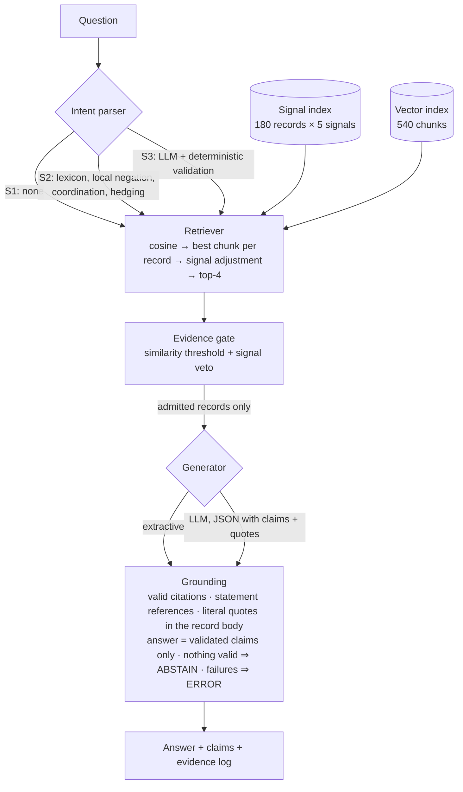

# Decision Intelligence RAG: Evidence-Grounded Retrieval and Answer Generation

An independent research implementation for evaluating evidence-grounded RAG architectures, semantic retrieval strategies, answer correctness, and citation faithfulness.

The project is a reproducible experimental platform built around one question: when a retrieval-augmented system answers questions about organisational decisions, which components actually make the answers more correct and better grounded? The candidates are the retriever, a semantic interpretation of the question, and the generator.

> **Status.** The current protocol is **v2**. It has been frozen, and its holdout was run once for the offline configurations A and B. The v2 results are **exploratory**: the system never saw the holdout before the freeze, but the questions and corpus were written by the author of the system. **Protocol v1** is kept as a historical record only, because its holdout was inspected during an audit and its rule parser had defects that v2 fixes. Configurations C–F need an LLM. They are implemented and tested with scripted models but **have not been executed**, and this repository reports no LLM result. See [`experiments/README.md`](experiments/README.md).

## Problem

Organisations record decisions together with the reasons behind them: a vendor dependency, a legal obligation, a security requirement. Questions about those records are often constraints rather than topics, for example *"which decisions about the payroll system depend on an outside firm?"* or *"…explicitly have no legal basis?"*. Vector similarity finds records about the right subject, but it cannot tell whether a record satisfies, contradicts or ignores the constraint. A generator can then cite irrelevant records, or answer questions that the corpus cannot answer.

## Research questions

1. **RQ1.** Does a semantic-signal layer, using rule-based or LLM-based question interpretation, improve retrieval over a pure vector baseline?
2. **RQ2.** How much of answer quality comes from the generator rather than from the retriever?
3. **RQ3.** How well do an evidence gate and citation validation prevent answers to unanswerable questions?

## Architecture



| Component | What it does |
|---|---|
| **Synthetic corpus (v2)** | 180 fictional decision records (10 domains × 3 subjects × 6 actions) split into 540 chunks. The phrase pools mix sentences that use the lexicon's cue words, cue-free paraphrases, and distractors |
| **Embeddings** | An offline signed feature-hashing embedder (no credentials), and an optional OpenAI-compatible embedder whose vectors are validated (finite, consistent dimension) and cached per endpoint |
| **Semantic signals** | Five signals (third-party dependency, operational motivation, legal dependency, security dependency, compliance relevance), labelled by a rule classifier with local negation and entity masking, or by an optional LLM classifier |
| **Retrieval** | Three strategies behind one ranker: vector baseline, rule-based enrichment, and LLM semantic intent |
| **Generation** | A deterministic extractive generator, and an LLM generator whose shown answer is composed only of validated claims |
| **Answer states** | An explicit state machine: ANSWER needs validated claims, ABSTAIN shows only the abstention message, and provider or schema failures are ERROR, never ABSTAIN |
| **Evaluation** | Configurations A–F, lexical and LLM judges applied only after the state rule, per-question paired sign tests, dev-only calibration, and a frozen manifest with separate pipeline and evaluation hashes |
| **Interface** | A Streamlit app with ask, compare, measured-results and corpus views. It works fully offline |

Details: [`docs/architecture.md`](docs/architecture.md).

## Experimental design

| ID | Retrieval | Generator | Isolates |
|---|---|---|---|
| A | Vector baseline | Deterministic | baseline |
| B | Rule-based semantic enrichment | Deterministic | rule-based signals without an LLM |
| C | Vector baseline | LLM | the LLM generator |
| D | Rule-based semantic enrichment | LLM | rule-based signals with an LLM |
| E | LLM-based semantic intent | LLM | LLM intent with an LLM |
| F | LLM-based semantic intent | Deterministic | LLM intent without an LLM generator |

* **Questions (v2).** 70 hand-written phrasings, each used once, in ten categories: three kinds of lookup; signal, negated, conjunction, disjunction and hedged filters; and unanswerable questions both **inside** the domain (asking for information the records never contain) and outside it. A seeded draw assigns subjects and records, so the author did not pick them. Expected evidence comes from the generator's intended labels. The split is drawn per category in proportion: 20 dev and 50 holdout questions.
* **Protocol.** Development and threshold calibration use the dev split only. `dirag freeze` records hashes of data, prompts, parameters, configurations, source code, the dependency lock and provider identity. The runner refuses the holdout if anything in them has changed. Deterministic configurations run once, because repeating them produces identical rows, not new observations. LLM configurations run three repetitions.
* **Metrics.** Recall@4, supporting-source precision, answer correctness, citation faithfulness (model-written quotes only), correct-abstention and false-answer rates on unanswerable questions, latency and cost. Operational failures are counted separately. Configurations are compared question by question with an exact sign test.

Full protocol: [`docs/methodology.md`](docs/methodology.md). Metric definitions: [`docs/evaluation.md`](docs/evaluation.md).

## Installation

Requires Python 3.12 or 3.13 (both tested in CI) and [uv](https://docs.astral.sh/uv/).

```bash
git clone https://github.com/LorenzoNMachado/decision-intelligence-rag.git
cd decision-intelligence-rag
uv sync --extra app        # core + Streamlit; omit --extra app for the CLI only
```

## Quick start (offline, no API keys)

```bash
uv run dirag corpus-validate                       # integrity of the committed v2 data
uv run dirag ask "Which decisions about the feature flag service have security dependencies?" \
    --retrieval rules                              # Strategy 2 + extractive generator
uv run streamlit run app/streamlit_app.py          # interactive demo on http://localhost:8501
```

An out-of-domain question is gated before generation:

```text
$ uv run dirag ask "Which catering company was selected for the staff cafeteria contract?"
"status": "ABSTAIN", "abstain_reason": "no document passed the evidence gate"
```

A question about a real record that asks for information the corpus never contains is **not** gated. The offline system answers it with unrelated sentences. This is a measured failure (see the results), not a hidden one:

```text
$ uv run dirag ask "What budget was approved for the decision to adopt a customer data warehouse?"
"status": "ANSWER"   ← no record states a budget
```

## Configuring an LLM provider (optional)

Everything above runs offline, with no network access, credentials or paid services. LLM features are opt-in and configured only through environment variables (see [`.env.example`](.env.example)):

| Variable | Purpose |
|---|---|
| `DIRAG_LLM_BASE_URL` | Endpoint of any OpenAI-compatible `/chat/completions` server (a hosted API, a gateway or a local server). It is recorded in manifests without credentials, query or fragment |
| `DIRAG_LLM_MODEL` / `DIRAG_JUDGE_MODEL` | Generator / intent model and judge model |
| `DIRAG_LLM_API_KEY` | Credential. It is read only from the environment and redacted from every error message, result and manifest |
| `DIRAG_PRICE_PROMPT_PER_MTOK` / `DIRAG_PRICE_COMPLETION_PER_MTOK` | Token prices. **Required** when a spending limit is set |
| `DIRAG_BUDGET_USD` | Spending limit per process (default 1.0). Use `none` to disable it explicitly |

**What the spending limit does and does not guarantee.** Before each request, the client computes an upper bound of its cost: the request bytes at the prompt price plus `max_tokens` at the completion price. It refuses to send the request when that bound does not fit in the remaining budget. Without configured prices no bound exists, so it refuses to send at all (fail closed). After the response, it charges the provider-reported cost when that is a valid non-negative number, otherwise the configured prices applied to the reported usage, otherwise the bound. Requests that may have been billed without usable accounting, such as timeouts or malformed bodies, are charged at the bound. Unknown costs are never recorded as zero. The limit holds only if the configured prices match the provider's and the provider counts at most one token per byte and honours `max_tokens`. What you actually pay is set by the provider's billing.

While the provider variables are unset, the interface hides the LLM options. CLI commands that need an LLM then exit with code 2 and a message, without writing partial results.

## Reproducing the experiments

```bash
# Offline (no credentials), protocol v2
uv run dirag verify-manifest                       # v2 manifest intact (warnings: other Python/numpy)
uv run dirag verify-v1                             # historical v1 artefacts identical to commit 30bce65
uv run dirag corpus-generate --out /tmp/regen      # regenerates data/v2 byte-for-byte
uv run dirag signals-evaluate                      # rule classifier vs generator labels
uv run dirag calibrate                             # dev-only evidence-gate sweep
uv run dirag run --split dev --configs A,B --name my-dev-run
uv run dirag run --split holdout --configs A,B --name my-holdout-run

# With an OpenAI-compatible LLM provider (see .env.example)
set -a; source .env; set +a
uv run dirag run --split dev --configs C,D,E,F --name llm-dev
uv run dirag amend-providers --note "pin the LLM provider before the first LLM holdout run"
uv run dirag run --split holdout --configs C,D,E,F --name llm-holdout
uv run dirag judge --name llm-holdout              # judges only answered answerable rows
uv run dirag report --name llm-holdout
```

Commands never overwrite results. An existing run is continued only with `--resume`, and only if its setup is unchanged. Every run writes `rows.jsonl`, `metadata.json` (with a log of sessions) and `summary.{json,csv,md}` under `experiments/v2/results/<name>/`. Runs with LLM intent also write `intents.jsonl`, so a resumed run reuses the same interpretations.

## Results measured with this implementation

All numbers come from the offline lexical embedder `hashing-v1` and the **lexical key-fact proxy** for correctness, not an LLM judge. Each configuration is deterministic and ran once. The unit of comparison is the question.

### Protocol v2 (current, exploratory)

**Holdout: 50 questions (40 answerable, 10 unanswerable: 6 in-domain, 4 out of domain).** The protocol was frozen at commit `58f57ba` and the holdout run once afterwards, with no change to the system. Source: [`experiments/v2/results/holdout-ab/`](experiments/v2/results/holdout-ab/summary.md).

| Metric | A · vector + extractive | B · rules + extractive |
|---|---:|---:|
| Recall@4 | 0.865 | 0.810 |
| Supporting-source precision | 0.369 | 0.381 |
| Correctness, lexical proxy (strict / partial) | 0.050 / 0.675 | 0.100 / 0.525 |
| Correct abstention, in-domain unanswerable | 0/6 | 0/6 |
| Correct abstention, out-of-domain unanswerable | 3/4 | 3/4 |
| False-abstention rate, answerable | 0.000 | 0.000 |
| Records cited that are not expected | 101 | 98 |

| Paired comparison, A → B (per question) | B better | A better | Ties | Sign test p |
|---|---:|---:|---:|---:|
| Recall@4 (40 answerable questions) | 6 | 5 | 29 | 1.00 |
| Strictly correct (50 questions) | 2 | 0 | 48 | 0.50 |

Recall@4 by category on the holdout (A → B): signal filters 0.708 → 0.842 (10 questions), conjunctions 0.875 → 1.000 (4), hedged 0.667 → 0.750 (3), disjunctions 0.667 → 0.583 (3), **negated filters 1.000 → 0.333 (6)**. All lookups score 1.000 for both. The rule classifier reaches 78.3 % macro accuracy against the generator's labels on the v2 corpus (93.9 % on v1). The drop is expected, because the v2 pools were written to avoid the lexicon's vocabulary.

**Reading these results.**

* *RQ1:* **no evidence of improvement.** B wins on positive signal filters and loses heavily on negated filters. Overall, the paired difference is indistinguishable from chance. The failure on negation was diagnosed after the holdout run and was not fixed, because fixing it now would tune the system on the holdout ([`experiments/v2/README.md`](experiments/v2/README.md)). The cause is that records whose intended label is ABSENT receive a false PRESENT label from distractor sentences, and the bonus for matching ABSENT pulls in records of other subjects.
* *RQ3:* **the gate does not prevent in-domain false answers.** None of the six in-domain unanswerable questions was abstained, and one out-of-domain question was answered on lexical overlap alone.
* *The extractive generator* cites every admitted record, so strict correctness stays near zero by construction. Its citation faithfulness is not reported, because its quotes are copied from the record.
* *RQ2* requires configurations C–F, which are pending.

### Protocol v1 (historical, superseded)

Kept unchanged in `experiments/results/` and verified by `dirag verify-v1`. On its holdout (40 questions), Recall@4 was 0.932 for A and 0.948 for B, and correct abstention 8/8 for both. An independent audit established that:

* the improvement was small: 5 questions better and 2 worse, sign test p ≈ 0.453;
* the three repetitions were identical deterministic runs, not independent observations;
* the vector baseline already had high recall: a random choice of 4 of a subject's 5 records reaches 0.80;
* the rule lexicon and the generator's templates shared vocabulary: the lexicon labelled all 33 templates as intended;
* both regressions came from parser defects ("outside" read as a negation in Q-038; a subject word read as a constraint in Q-012), not one negated question as first reported;
* the perfect abstention was measured only on out-of-domain questions, and the system answered 4 of 6 in-domain probes;
* the reported citation faithfulness of 1.000 held by construction for extractive quotes;
* the latency difference reflected warm-up order, not speed.

These points are why protocol v2 exists. v1 numbers are not comparable with v2: the corpus, the questions and the code differ.

## Limitations

The main limitations:

* synthetic data, with references derived from the generator;
* the author of the system also wrote the corpus, the lexicon and the questions (v2 is exploratory, not confirmatory);
* few questions per category;
* a lexical offline embedder and a lexical correctness proxy;
* no LLM results.

See [`docs/limitations.md`](docs/limitations.md).

## Development

```bash
uv run ruff check src tests app && uv run ruff format --check src tests app
uv run mypy                     # strict mode
uv run pytest                   # unit, integration and regression tests, including a headless app test
```

CI runs the same checks on Python 3.12 and 3.13, with no secrets. It also regenerates the v2 data and diffs it, verifies the v2 manifest, and checks the v1 artefacts against the v1 commit. The test suite removes any `DIRAG_*` variables from its environment and uses mock transports, so it never contacts a provider.

## References

* Lewis, P. et al. (2020). Retrieval-Augmented Generation for Knowledge-Intensive NLP Tasks. *NeurIPS*.
* Karpukhin, V. et al. (2020). Dense Passage Retrieval for Open-Domain Question Answering. *EMNLP*.
* Chapman, W. W. et al. (2001). A Simple Algorithm for Identifying Negated Findings and Diseases in Discharge Summaries. *Journal of Biomedical Informatics*, 34(5).
* Gao, T., Yen, H., Yu, J., Chen, D. (2023). Enabling Large Language Models to Generate Text with Citations. *EMNLP*.
* Rashkin, H. et al. (2023). Measuring Attribution in Natural Language Generation Models. *Computational Linguistics*, 49(4).
* Min, S. et al. (2023). FActScore: Fine-grained Atomic Evaluation of Factual Precision in Long Form Text Generation. *EMNLP*.
* Es, S., James, J., Espinosa-Anke, L., Schockaert, S. (2024). RAGAS: Automated Evaluation of Retrieval Augmented Generation. *EACL System Demonstrations*.
* Kamath, A., Jia, R., Liang, P. (2020). Selective Question Answering under Domain Shift. *ACL*.
* Zheng, L. et al. (2023). Judging LLM-as-a-Judge with MT-Bench and Chatbot Arena. *NeurIPS Datasets and Benchmarks*.
* Weinberger, K. et al. (2009). Feature Hashing for Large Scale Multitask Learning. *ICML*.
* Youden, W. J. (1950). Index for Rating Diagnostic Tests. *Cancer*, 3(1).

## Author

**Lorenzo Nakayama Machado**, Pontifícia Universidade Católica do Paraná (PUCPR).
This repository is an independent implementation of concepts studied during applied research in Computer Science. It does not reproduce, and makes no claims about, the results of that earlier study.

## License

Released under the [MIT License](LICENSE). Runtime dependencies are under permissive licenses (BSD, MIT, Apache-2.0), except `certifi`, which is MPL-2.0 and used unmodified as a dependency of `httpx`.
