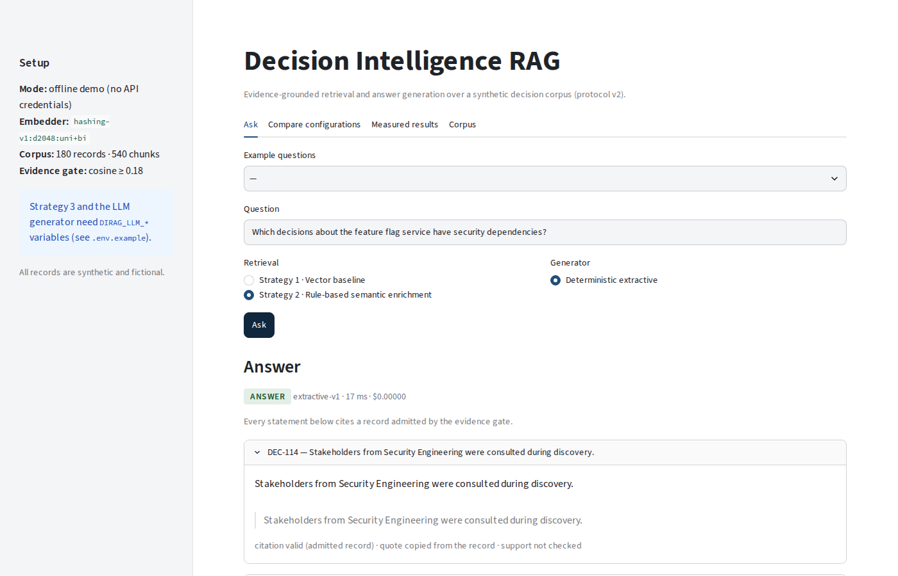
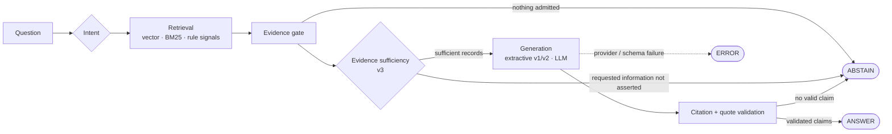
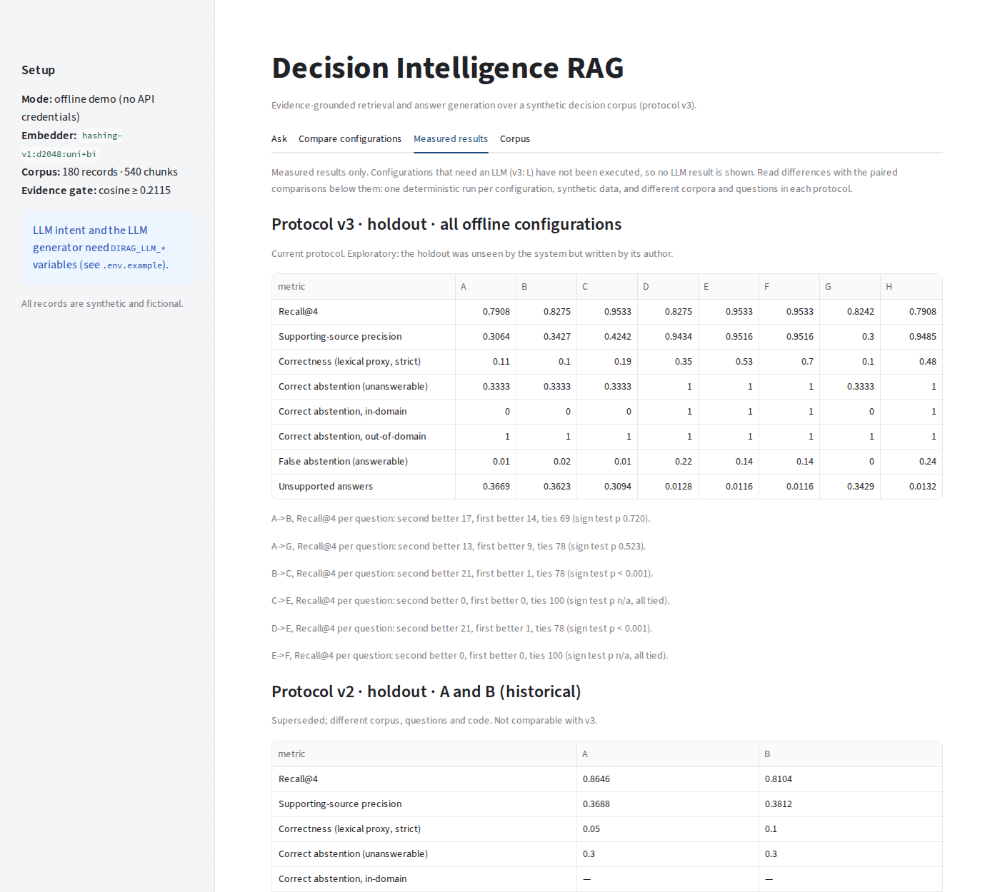

# Decision Intelligence RAG

*Evidence-grounded retrieval, answer generation, and reproducible RAG evaluation.*

[](https://github.com/LorenzoNMachado/decision-intelligence-rag/actions/workflows/tests.yml)
[](pyproject.toml)
[](LICENSE)

## Project overview

Decision Intelligence RAG is a research testbed for retrieval-augmented generation over organisational decision records. You can try different retrieval, evidence-checking and generation mechanisms on a synthetic corpus and measure how each one affects retrieval quality, answer correctness, grounding and abstention.

It is **a research implementation, not a production system**. It runs fully offline, needs no API key, and every reported number comes from a frozen, verifiable protocol.



> **Status.** Protocol **v3** is current. It is frozen, and its holdout was run once for the eight offline configurations (A–H). The results are **exploratory**: the system was frozen before the v3 corpus and questions were written, but one author wrote all of them. Protocols v1 and v2 are kept as verifiable historical records and are not comparable with v3. The configuration that needs an LLM (L) is implemented and tested with scripted models but **has not been executed**. An adversarial audit of v3 (not independent: same AI agent as the implementation) is in [`docs/audits/v3/`](docs/audits/v3/README.md); it qualifies several of the results below.

## Research problem

Questions about decisions are often constraints ("which decisions about the identity directory involve no external vendor?") or requests for one fact ("what budget was approved for the decision to …?"). Protocol v2 showed three ways a retrieval pipeline fails at them ([diagnosis](docs/v3/diagnosis.md)):

1. a similarity gate admits records that **name the right decision but do not contain the requested fact**, so in-domain unanswerable questions get answered;
2. a single distractor ("the vendor management office reviewed …") outweighs an explicit negation, and signal bonuses can lift records of other subjects;
3. an extractive answer can cite the right record but quote a sentence that does not answer.

Protocol v3 tests mechanisms aimed at each failure ([plan](docs/v3/protocol.md), registered before any run).

## Key features

- **Evidence sufficiency check (v3).** Between retrieval and generation, the check decides from the question text and the admitted records alone whether a record *asserts* what is asked. Possible outcomes are a current value of the expected type about the requested attribute, every required condition with the requested polarity, a partial match, ambiguity, or nothing; otherwise the system abstains. Topicality also uses the records' structured `subject` and `domain` fields, so the system does not work from unstructured text alone.
- **Assertion scope (v3).** Each mention is factual, negated, hypothetical, historical or merely contextual. Records that assert both polarities are labelled contradictory instead of "PRESENT wins". Its measured contribution to the sufficiency results is small (one holdout question); see the audit.
- **Controlled ablation.** The v2 semantic layer is kept unchanged next to the v3 one; a BM25 lexical baseline sits next to the hashing embedder; and extractive generators v1 (word overlap) and v2 (quotes the sentence the check found) are compared on the same records.
- **Explicit answer states.** ANSWER, ABSTAIN and ERROR. Insufficient evidence is a recorded abstention reason, and provider failures are never counted as abstentions.
- **Reproducible evaluation.**
  - Dev-only calibration.
  - A frozen manifest that hashes data, prompts, parameters, code, the dependency lock and provider identity.
  - Paired sign tests and bootstrap intervals per question.
  - Wilson intervals.
  - Historical protocols verified against their git commits.
- **Fully offline by default.** No network calls, no API key and no model download.

## Architecture



LLM intent and the LLM generator are optional stages that need a provider. Details, including the offline vs LLM paths, are in [`docs/architecture.md`](docs/architecture.md).

## Quick start

Requires Python 3.12 or 3.13 and [uv](https://docs.astral.sh/uv/). No API key, account, database or model download is needed.

```bash
git clone https://github.com/LorenzoNMachado/decision-intelligence-rag.git
cd decision-intelligence-rag
uv sync --locked --extra app            # add --python 3.13 to use Python 3.13

uv run dirag corpus-validate            # the synthetic corpus is committed; this checks it
uv run dirag ask "What budget was approved for the decision to trial a patient scheduling system?" \
    --retrieval rules-v3 --sufficiency --generator extractive-v2
uv run streamlit run app/streamlit_app.py   # http://localhost:8501

uv run pytest                           # test suite (offline, providers mocked)
uv run dirag verify-manifest            # protocol v3 unchanged since its freeze
uv run dirag verify-v2 && uv run dirag verify-v1   # historical protocols intact
```

`make help` lists the same commands as short targets (`make install`, `make ask`, `make app`, `make check`).

`dirag ask` prints a JSON record with the parsed intent, the ranked records with their gate decisions, the sufficiency report (the information asked for, and a status and reason per record) and the answer. The same question about a record that states no budget abstains:

```text
$ uv run dirag ask "What budget was approved for the decision to introduce a patient scheduling system?" \
    --retrieval rules-v3 --sufficiency --generator extractive-v2
→ "status": "ABSTAIN", "abstain_reason": "INSUFFICIENT: no admitted record contains the requested MONEY"
```

## Interactive demo

The Streamlit app (`uv run streamlit run app/streamlit_app.py`) runs offline. Its Ask and Compare tabs are labelled as live demonstrations, not measured results; LLM options appear only when provider variables are set. The screenshots come from the real app in offline mode (`scripts/capture_screenshots.py`).

**Evidence.** For each retrieved record the app shows its similarity, adjusted score, topical eligibility, gate decision, matched signals and **sufficiency status with its reason**, plus the sentences that support the answer.


**Measured results.** Results are shown per protocol, v3 first and v1/v2 marked historical, with paired comparisons.



## Experimental configurations

| ID | Retrieval | Sufficiency | Generator | Status |
|---|---|---|---|---|
| A | vector (hashing) | — | extractive-v1 | measured |
| B | rules-v2 (v2 semantic layer) | — | extractive-v1 | measured |
| C | rules-v3 (scoped labels, topical ranking) | — | extractive-v1 | measured |
| D | rules-v2 | ✓ | extractive-v1 | measured |
| E | rules-v3 | ✓ | extractive-v1 | measured |
| F | rules-v3 | ✓ | extractive-v2 | measured |
| G | BM25 | — | extractive-v1 | measured |
| H | vector | ✓ | extractive-v2 | measured |
| L | rules-v3 | ✓ | LLM | **not executed** |

**Protocol v3 data.**
- 180 synthetic records (540 chunks, about 105 words each).
- 224 questions in 8 categories, 8 dev + 20 holdout each (sizes fixed beforehand).
- Categories: entity and fact lookups; the **same phrasings** about records that do *not* state the attribute (in-domain unanswerables); signal, negated and multi-condition filters; out-of-domain questions.

**Optional LLM providers.** Any OpenAI-compatible endpoint can be configured through environment variables (see [`.env.example`](.env.example)). Token prices are required whenever a spending limit is set. Before each request the client computes an upper bound of its cost and refuses requests that might exceed the limit or whose cost cannot be bounded. The limit is only as accurate as the configured prices; the provider's billing is authoritative.

## Measured results

Protocol v3 holdout: 160 questions (100 answerable, 40 in-domain unanswerable, 20 out of domain). Lexical correctness proxy; one deterministic run per configuration; the question is the unit of comparison. Source: [`experiments/v3/`](experiments/v3/README.md).

| | A | B | C | D | E | F | G | H |
|---|---:|---:|---:|---:|---:|---:|---:|---:|
| Retrieval | vector | rules-v2 | rules-v3 | rules-v2 | rules-v3 | rules-v3 | BM25 | vector |
| Sufficiency check | — | — | — | ✓ | ✓ | ✓ | — | ✓ |
| Generator | ext-v1 | ext-v1 | ext-v1 | ext-v1 | ext-v1 | ext-v2 | ext-v1 | ext-v2 |
| Recall@4 (n = 100) | 0.791 | 0.828 | **0.953** | 0.828 | 0.953 | 0.953 | 0.824 | 0.791 |
| Supporting-source precision | 0.306 | 0.343 | 0.424 | 0.943 | 0.952 | 0.952 | 0.300 | 0.948 |
| Strict correctness (n = 100) | 0.110 | 0.100 | 0.190 | 0.350 | 0.530 | **0.700** | 0.100 | 0.480 |
| Correct abstention, in-domain | 0/40 | 0/40 | 0/40 | 40/40 | 40/40 | 40/40 | 0/40 | 40/40 |
| Correct abstention, out-of-domain | 20/20 | 20/20 | 20/20 | 20/20 | 20/20 | 20/20 | 20/20 | 20/20 |
| False abstention, answerable | 1/100 | 2/100 | 1/100 | 22/100 | 14/100 | 14/100 | 0/100 | 24/100 |
| Unsupported answers (share of ANSWER) | 0.367 | 0.362 | 0.309 | 0.013 | 0.012 | 0.012 | 0.343 | 0.013 |

8 configurations × 160 questions = 1,280 result rows. "rules-v2" is the v2 semantic layer (v2 lexicon and classifier, flat ranking); "rules-v3" is the scoped classifier, v3 parser and topical ranking; ext-v1 quotes the sentence with the most shared words, ext-v2 the sentence the sufficiency check found.

Pre-specified comparisons (paired, per question):

- **Sufficiency (E vs C):** in-domain abstention 0/40 → 40/40, at the cost of 14 false abstentions in 100 answerable questions.
- **Corrected semantic layer (C vs B):** Recall@4 +0.126 (95 % CI 0.073–0.183; 21 better, 1 worse; sign test p < 0.001), mostly on negated filters (0.579 → 0.933).
- **Generator (F vs E):** strict correctness 0.53 → 0.70 on the 100 answerable questions, **+0.17** (95 % CI 0.10–0.25; 17 better, 0 worse). The stored summary also lists +0.106 for this pair: that figure is the same 17 questions divided by all 160 questions, unanswerable ones included.
- **BM25 vs hashing (G vs A):** no difference (p = 0.52).

**How to read these numbers:**

- They are **exploratory** results on a **synthetic** corpus written by the author of the system.
- **The 40/40 does not show robust interpretation of scope.** In 29 of the 40 target records there is no value of the requested type at all. With the assertion-scope classification switched off, the check still abstains on 39/40 (on 30/40 if the attribute-word requirement is also removed). Scope changed the outcome of one question. The check's patterns also mirror the corpus generator's templates.
- **Outside the generator's wording the check often fails.** On 37 adversarial cases written by the auditing agent (not a random sample, not an independent annotation), 12 pass: 6 of the 13 that should be declined are declined, and 7 are answered without support (a rejected budget, a withdrawn approval, savings taken as the budget, contradictory values). See the [audit](docs/audits/v3/README.md) and its [known issues](docs/audits/v3/known-issues.md).
- **Part of the precision comes from structured metadata.** Without the `subject` and `domain` fields, which also define the gold standard of the filter questions, F's supporting-source precision falls from 0.952 to 0.873 and its strict correctness from 70 to 62 answerable questions.
- **The holdout is frozen, not independent in form.** 89 of its 140 in-domain questions use a phrasing that also occurs in the dev split, where defects were found and fixed.
- **Most of the retrieval gain comes from the scoped signal index.** With the v2 parser it raises Recall@4 from 0.828 to 0.913; the v3 parser adds about 0.04; topical ranking adds 0.000–0.005. On 24 new paraphrases the v3 classifier labels 10 correctly (v2: 9), against 28 of the generator's own 33 phrases, so the gain is specific to this corpus.
- **The false abstentions come from paraphrase gaps.** "Funding" for "budget", "staff" for "employees", and conditions stated without lexicon words: limits of a lexical approach.
- Correctness uses a lexical proxy, and **no LLM configuration has been run**.

Earlier protocols are historical records ([v2](experiments/v2/README.md), [v1](experiments/v1/README.md)); their numbers were measured on other corpora and questions and are not comparable with v3.

## Reproducibility

- **Data.** `uv run dirag corpus-generate --out /tmp/regen` regenerates `data/v3` byte for byte; CI diffs it on every pull request.
- **Results.** `uv run dirag run --split holdout --configs A,B,C,D,E,F,G,H --name my-run` reproduces the committed holdout rows, apart from latency. Runs never overwrite results.
- **Protocol.** `uv run dirag verify-manifest` checks the v3 freeze. `uv run dirag verify-v2` and `verify-v1` check the historical protocols against the git commits that published them, recomputing their manifest inputs.
- **CI** (Python 3.12 and 3.13) runs lint, strict type checking, tests, a package build, data regeneration and all three protocol checks. Security workflows scan full history (gitleaks), audit locked dependencies (pip-audit), run Bandit and CodeQL.

## Technical documentation

| Document | Contents |
|---|---|
| [`docs/v3/diagnosis.md`](docs/v3/diagnosis.md) | The v2 failures that motivated v3, reproduced |
| [`docs/v3/protocol.md`](docs/v3/protocol.md) | Hypotheses, configurations, primary comparisons, sizes, calibration, changes after the data was written |
| [`experiments/v3/README.md`](experiments/v3/README.md) | Measured results, ablation, failure analysis, threats to validity |
| [`docs/audits/v3/`](docs/audits/v3/README.md) | Adversarial audit of v3: findings, pre-registered cases, scripts, outputs, [known issues](docs/audits/v3/known-issues.md) |
| [`docs/security-review.md`](docs/security-review.md) | Security boundaries, current controls and open prompt-injection and evidence-poisoning risks |
| [`docs/architecture.md`](docs/architecture.md) | Components, data flow, offline vs LLM stages, design decisions |
| [`docs/evaluation.md`](docs/evaluation.md) | Metric formulas and denominators, intervals, what each grounding check shows |
| [`docs/limitations.md`](docs/limitations.md) | Known failures and threats to validity |
| [`docs/methodology.md`](docs/methodology.md), [`docs/results.md`](docs/results.md) | Protocol v2 method and results (historical) |
| [`experiments/README.md`](experiments/README.md) | Execution status of every study, per protocol |

## Limitations

- **Synthetic data and one author** for the system, the corpus and the questions. There is no independent annotation.
- **Lexical everywhere:** cue lexicon, hashing embedder, BM25 and correctness proxy. Paraphrases without known words are missed.
- **20 holdout questions per category.** Per-category differences are descriptive.
- **Rules coupled to the corpus generator**, a holdout that shares phrasings with dev, and topicality that relies on structured `subject`/`domain` fields.
- **Unsupported answers on non-template wording** (rejected, withdrawn or contradictory values), found by the audit.
- **No LLM results.**

See [`docs/limitations.md`](docs/limitations.md).

## Future work

- Run configuration L with a provider, in the documented order: dev run, provider freeze, holdout run, judge.
- Have questions and near misses written by someone who does not know the sufficiency rules, and add human relevance labels.
- Address the defects catalogued in [`docs/audits/v3/known-issues.md`](docs/audits/v3/known-issues.md) in a new protocol, with near misses, paraphrases and question formats that are not shared between dev and holdout.
- Evaluate a dense embedding model with its own calibration.

## References

* Lewis, P. et al. (2020). Retrieval-Augmented Generation for Knowledge-Intensive NLP Tasks. *NeurIPS*.
* Karpukhin, V. et al. (2020). Dense Passage Retrieval for Open-Domain Question Answering. *EMNLP*.
* Robertson, S., Zaragoza, H. (2009). The Probabilistic Relevance Framework: BM25 and Beyond. *Foundations and Trends in Information Retrieval*, 3(4).
* Li, X., Roth, D. (2002). Learning Question Classifiers. *COLING*.
* Rajpurkar, P., Jia, R., Liang, P. (2018). Know What You Don't Know: Unanswerable Questions for SQuAD. *ACL*.
* Peffers, K. et al. (2007). A Design Science Research Methodology for Information Systems Research. *Journal of Management Information Systems*, 24(3).
* Chapman, W. W. et al. (2001). A Simple Algorithm for Identifying Negated Findings and Diseases in Discharge Summaries. *Journal of Biomedical Informatics*, 34(5).
* Gao, T., Yen, H., Yu, J., Chen, D. (2023). Enabling Large Language Models to Generate Text with Citations. *EMNLP*.
* Rashkin, H. et al. (2023). Measuring Attribution in Natural Language Generation Models. *Computational Linguistics*, 49(4).
* Es, S., James, J., Espinosa-Anke, L., Schockaert, S. (2024). RAGAS: Automated Evaluation of Retrieval Augmented Generation. *EACL System Demonstrations*.
* Kamath, A., Jia, R., Liang, P. (2020). Selective Question Answering under Domain Shift. *ACL*.
* Weinberger, K. et al. (2009). Feature Hashing for Large Scale Multitask Learning. *ICML*.
* Youden, W. J. (1950). Index for Rating Diagnostic Tests. *Cancer*, 3(1).

## License and author

Released under the [MIT License](LICENSE). Runtime dependencies use permissive licenses (BSD, MIT, Apache-2.0), except `certifi` (MPL-2.0, unmodified, a dependency of `httpx`).

**Lorenzo Nakayama Machado**, Pontifícia Universidade Católica do Paraná (PUCPR). This repository is an independent implementation of concepts studied during applied research in Computer Science. It does not reproduce, and makes no claims about, the results of that earlier study.

Contributions: see [`CONTRIBUTING.md`](CONTRIBUTING.md). Security reports: see [`SECURITY.md`](SECURITY.md).
