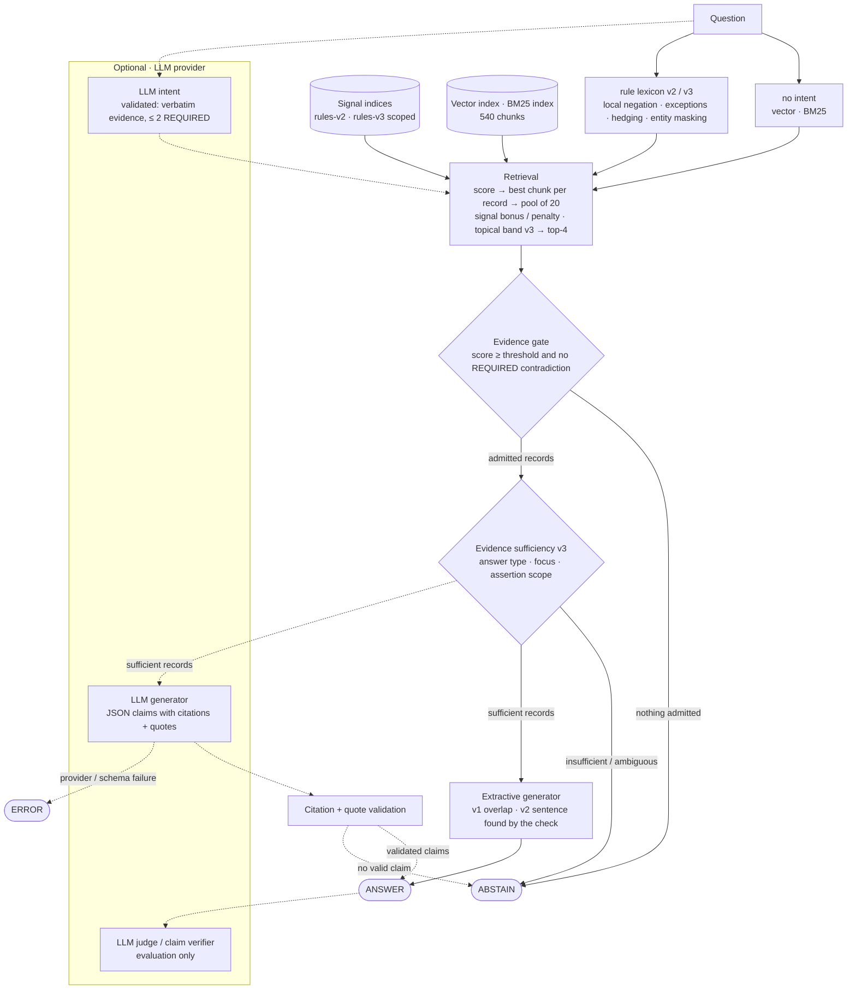

# Architecture

## Overview

Solid boxes run offline and are exercised by the measured configurations A–H
of protocol v3. Boxes inside "Optional · LLM provider" and dashed edges are
implemented and tested with scripted models only; they are inactive unless
`DIRAG_LLM_*` is configured, and no result from them has been measured.

Configurations without the sufficiency check (A, B, C, G) go from the gate
straight to the generator, as in protocol v2. Final states follow
`models.TRANSITIONS`: an answer exists only with claims, an abstention shows
only the abstention message (with the check's reason when it decided), and an
error is never an abstention.

## Evidence sufficiency (v3)

`decision_intelligence.sufficiency` sees the question text, the retrieval
result and the records, never a reference answer or a category:

1. **Information need** (`need.py`): the expected answer type from the
   question's structure (wh-form and the noun it governs, using a small
   taxonomy of answer-type nouns), the focus words, and the referenced decision.
2. **Typed facts** (`facts.py`): money, dates, counts, people, organisations,
   regulations, frameworks and stated reasons, found with general patterns,
   each with the assertion type of its clause.
3. **Assertion scope** (`semantic_signals/scope.py`): FACTUAL, NEGATED,
   HYPOTHETICAL, HISTORICAL or CONTEXTUAL per mention; a named organisation
   after a dependency phrase is a third-party mention.
4. **Decision per record** (`check.py`): OFF_TOPIC (another decision or
   subject; a referenced decision is matched by its title's words, a named
   subject or domain by the record's structured `subject`/`domain` fields,
   which the corpus generator writes and which also define the gold standard
   of the filter questions), SUFFICIENT (a current value of the right type about the requested
   attribute, or every required condition asserted), PARTIAL, AMBIGUOUS
   (both polarities asserted), INSUFFICIENT. Anything but SUFFICIENT overall
   is ABSTAIN with outcome `INSUFFICIENT_EVIDENCE`.

## Packages

| Package | Responsibility |
|---|---|
| `corpus` | Synthetic record generator, deterministic chunking, question-set builder, integrity validation, JSONL I/O |
| `embeddings` | `Embedder` protocol, exact cosine `VectorIndex`, offline `HashingEmbedder`, cached `OpenAICompatibleEmbedder` |
| `semantic_signals` | Versioned cue lexicons (v2, v3), assertion scope, rule-based (v2), scoped (v3) and LLM document classifiers, persisted `SignalIndex`, accuracy against generator labels |
| `intent` | `IntentParser` protocol with the none / rules / LLM parsers |
| `retrieval` | `Retriever`: similarity or BM25 scores, signal adjustment, flat or topical ranking, evidence gate; `BM25Scorer` |
| `generation` | Extractive and LLM generators; versioned prompts in `generation/prompts/*.md` |
| `grounding` | Evidence rendering, citation and quote validation, experimental claim verifier |
| `llm` | OpenAI-compatible chat client with classified errors, retries, response validation and fail-closed budget; `ScriptedLLM` for tests |
| `evaluation` | Metrics, judges (state rule + assessors), report, paired statistics and intervals, experiment runner, manifest (freeze/verify/amend), v1 and v2 historical verification, ablation and calibration |
| `sufficiency` | Information need, typed facts and the evidence-sufficiency checker (v3) |
| `config` | Protocol file, environment variables, component factory |
| `cli` | `dirag` command-line entry point |

`app/streamlit_app.py` is a thin interface over the same factory functions used by the CLI.

## Design decisions

**One retriever, three intent sources.** The strategies differ only in the intent
parser. With no active constraint the signal-aware path reduces exactly to the
vector baseline (a unit test asserts identical scores), so any difference
between strategies is caused by the semantic signals and nothing else.

**Neutral uncertainty.** UNCLEAR and ERROR labels neither add nor subtract
score. A classifier failure therefore degrades a strategy towards the baseline
instead of silently excluding documents.

**Gate on similarity, not on the adjusted score.** The evidence gate uses the raw
cosine similarity so that bonuses cannot admit an irrelevant document. Signal
contradiction of a REQUIRED constraint is an additional, optional veto.

**The LLM sees only admitted evidence.** When the gate admits nothing, the LLM
generator abstains without a model call. Citations outside the admitted set are
removed and logged, and an ANSWER without a surviving claim becomes ABSTAIN.

**The answer is the validated claims.** The text shown and judged is composed
from the claims that survived validation. The model's free-text answer is kept
only as `discarded_text`, so prose that names unsupported vendors or uncited
records never reaches the user or a judge.

**Explicit answer states.** `GeneratedAnswer` checks its invariants on
construction (`models.TRANSITIONS`): ANSWER needs claims, ABSTAIN shows only the
abstention message, and ERROR carries no text. Failures are ERROR, never
ABSTAIN, and correctness is graded by final state before any judge.

**Quote policy enforced in v2.** Protocol v2 runs with `quote_policy: "enforce"`.
The `record` policy (v1) is still supported, and the effect of enforcement can
be replayed from recorded rows (`quote_enforce_replay`).

**Fail closed on cost.** A limited budget authorises each request against an
upper bound computed from configured prices before sending. Unknown prices block
the request, and unknown costs are recorded as unknown, never as zero.

**OpenAI-compatible interfaces.** Both the embedder and the chat client target
the de-facto standard `/embeddings` and `/chat/completions` endpoints, so hosted
gateways, vendor endpoints and local servers can be swapped through environment
variables without code changes.

**Secrets stay in the environment.** API keys are read once in `config.py` and
never stored in result files or manifests. The configured key, Bearer tokens and
key-like strings are redacted from provider error messages. Endpoints are
recorded without credentials, query or fragment.

**Three protocols, one codebase.** The code runs protocol v3 only
(`Workspace(protocol="v3")`). The artefacts of v1 and v2 remain at their
original paths and are verified against the git objects of the commits that
published them (`evaluation.historical`, `evaluation.historical_v2`), never
recomputed. The v2 lexicon, classifier and flat ranking stay in the code,
unchanged, as configuration B of the v3 ablation; a test rebuilds the frozen v2
signal index byte for byte.

**Topical eligibility is a safeguard, not a measured gain.** In the v3 holdout
ablation, rules-v3 with and without the topical band reach the same Recall@4.
Most of the gain over rules-v2 comes from the scoped signal index, then the v3
parser ([audit](audits/v3/README.md), finding 6). The audit's catalogue of
known defects is [`audits/v3/known-issues.md`](audits/v3/known-issues.md).
