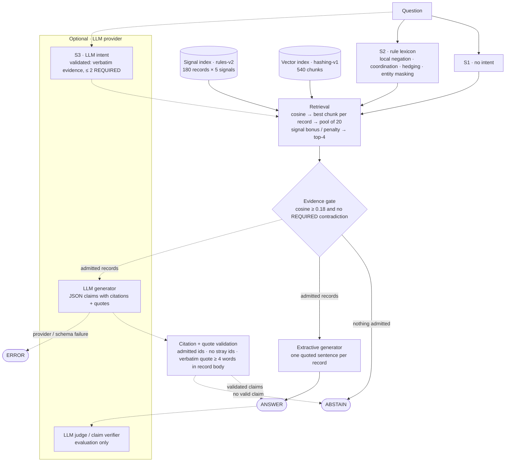

# Architecture

## Overview

Solid boxes run offline and are exercised by the measured configurations A and
B. Boxes inside "Optional · LLM provider" and dashed edges are implemented and
tested with scripted models only. They are not active unless `DIRAG_LLM_*` is
configured, and no result from them has been measured.

The final states follow `models.TRANSITIONS`. An answer exists only with
claims. An abstention shows only the abstention message. An error is never an
abstention. A failure anywhere in a run row (for example an embedding error) is
recorded as ERROR and the batch continues.

## Packages

| Package | Responsibility |
|---|---|
| `corpus` | Synthetic record generator, deterministic chunking, question-set builder, integrity validation, JSONL I/O |
| `embeddings` | `Embedder` protocol, exact cosine `VectorIndex`, offline `HashingEmbedder`, cached `OpenAICompatibleEmbedder` |
| `semantic_signals` | Cue lexicon, rule-based and LLM document classifiers, persisted `SignalIndex`, accuracy against generator labels |
| `intent` | `IntentParser` protocol with the none / rules / LLM parsers |
| `retrieval` | `Retriever`: similarity, signal adjustment, ranking and evidence gate |
| `generation` | Extractive and LLM generators; versioned prompts in `generation/prompts/*.md` |
| `grounding` | Evidence rendering, citation and quote validation, experimental claim verifier |
| `llm` | OpenAI-compatible chat client with classified errors, retries, response validation and fail-closed budget; `ScriptedLLM` for tests |
| `evaluation` | Metrics, judges (state rule + assessors), report and paired statistics, experiment runner, manifest (freeze/verify/amend), v1 historical verification, ablation and calibration |
| `config` | Protocol file, environment variables, component factory |
| `cli` | `dirag` command-line entry point |

`app/streamlit_app.py` is a thin interface over the same factory functions used by the CLI.

## Design decisions

**One retriever, three intent sources.** The strategies differ only in the intent
parser. With no active constraint the signal-aware path reduces exactly to the
vector baseline (a unit test asserts identical scores), so any difference
between strategies is caused by the semantic signals and nothing else.

**Neutral uncertainty.** UNCLEAR and ERROR labels neither add nor subtract
score. A classifier failure therefore degrades a strategy towards the baseline
instead of silently excluding documents.

**Gate on similarity, not on the adjusted score.** The evidence gate uses the raw
cosine similarity so that bonuses cannot admit an irrelevant document. Signal
contradiction of a REQUIRED constraint is an additional, optional veto.

**The LLM sees only admitted evidence.** When the gate admits nothing, the LLM
generator abstains without a model call. Citations outside the admitted set are
removed and logged, and an ANSWER without a surviving claim becomes ABSTAIN.

**The answer is the validated claims.** The text shown and judged is composed
from the claims that survived validation. The model's free-text answer is kept
only as `discarded_text`, so prose that names unsupported vendors or uncited
records never reaches the user or a judge.

**Explicit answer states.** `GeneratedAnswer` checks its invariants on
construction (`models.TRANSITIONS`): ANSWER needs claims, ABSTAIN shows only the
abstention message, and ERROR carries no text. Failures are ERROR, never
ABSTAIN, and correctness is graded by final state before any judge.

**Quote policy enforced in v2.** Protocol v2 runs with `quote_policy: "enforce"`.
The `record` policy (v1) is still supported, and the effect of enforcement can
be replayed from recorded rows (`quote_enforce_replay`).

**Fail closed on cost.** A limited budget authorises each request against an
upper bound computed from configured prices before sending. Unknown prices block
the request, and unknown costs are recorded as unknown, never as zero.

**OpenAI-compatible interfaces.** Both the embedder and the chat client target
the de-facto standard `/embeddings` and `/chat/completions` endpoints, so hosted
gateways, vendor endpoints and local servers can be swapped through environment
variables without code changes.

**Secrets stay in the environment.** API keys are read once in `config.py` and
never stored in result files or manifests. The configured key, Bearer tokens and
key-like strings are redacted from provider error messages. Endpoints are
recorded without credentials, query or fragment.

**Two protocols, one codebase.** The code runs protocol v2 only
(`Workspace(protocol="v2")`). Protocol v1's artefacts remain at their original
paths and are verified against the git objects of the v1 commit
(`evaluation.historical`), never recomputed.
