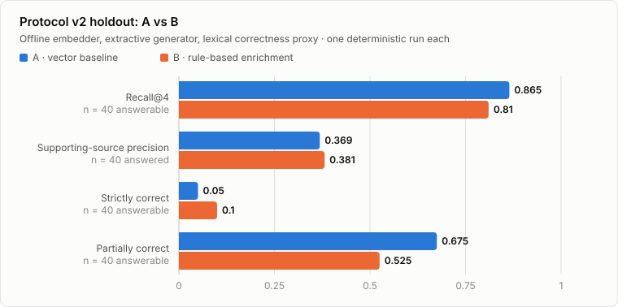
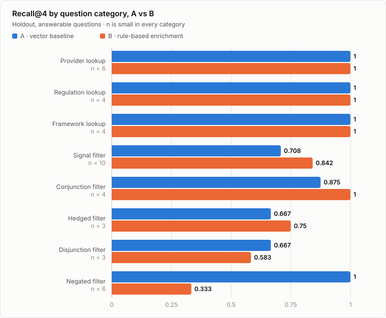
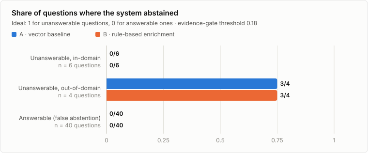

# Results (protocol v2, historical)

> Protocol v2 is superseded by protocol v3 ([`experiments/v3/README.md`](../experiments/v3/README.md)). The v2 numbers below were measured on a different corpus and question set and are not comparable with v3. They are kept because the failures they show motivated v3 ([`docs/v3/diagnosis.md`](v3/diagnosis.md)).

These are the only measured results of protocol v2: configurations A
(vector baseline + extractive generator) and B (rule-based semantic
enrichment + extractive generator) on the 50-question holdout. The holdout ran
once, after the freeze, with no change to the system afterwards. Every number
below is read from
[`experiments/v2/results/holdout-ab/`](../experiments/v2/results/holdout-ab/summary.md),
the [holdout ablation](../experiments/v2/results/ablation-holdout.json) or the
[classifier evaluation](../experiments/v2/results/signal-classifier-rules.json).
The figures are generated from the same files by `scripts/make_figures.py`.

**Status: exploratory.** The corpus is synthetic, and the questions, corpus and
system share one author. Configurations C–F (LLM) have not been executed.

## Summary

| Metric (holdout) | A | B | Denominator |
|---|---:|---:|---|
| Recall@4 | 0.865 | 0.810 | 40 answerable questions |
| Supporting-source precision | 0.369 | 0.381 | 40 answered answerable questions |
| Strictly correct (lexical proxy) | 0.050 (2/40) | 0.100 (4/40) | 40 answerable questions |
| Partially correct (lexical proxy) | 0.675 (27/40) | 0.525 (21/40) | 40 answerable questions |
| Abstained, in-domain unanswerable | 0/6 | 0/6 | 6 questions |
| Abstained, out-of-domain unanswerable | 3/4 | 3/4 | 4 questions |
| Abstained, answerable (false abstention) | 0/40 | 0/40 | 40 questions |

Per question, A → B on Recall@4: 6 better, 5 worse, 29 tied (exact two-sided
sign test p = 1.0). On strict correctness: 2 better, 0 worse, 48 tied (p = 0.5).

## Where the rules improved retrieval

| Category | n | A | B |
|---|---:|---:|---:|
| Signal filter | 10 | 0.708 | 0.842 |
| Conjunction filter | 4 | 0.875 | 1.000 |
| Hedged filter | 3 | 0.667 | 0.750 |

Where a question contains a cue word ("vendor", "legal", "auditors") and the
relevant records state the signal with cue words, the signal bonus lifts the
matching records above their siblings. Each subject has six records, and only
the top four are kept, so lifting the right ones changes recall.

## Where it regressed

| Category | n | A | B |
|---|---:|---:|---:|
| Disjunction filter | 3 | 0.667 | 0.583 |
| **Negated filter** | 6 | 1.000 | **0.333** |

The negated filters were diagnosed after the run (see
[`experiments/v2/README.md`](../experiments/v2/README.md)). The system was not
changed in response, because that would tune it on its own holdout.

1. Records whose intended label is ABSENT often also contain a distractor
   sentence. The classifier then labels them PRESENT, because PRESENT wins over
   ABSENT within a record, and the contradiction penalty removes them from the
   top four.
2. The bonus for matching ABSENT, applied over a 20-record candidate pool,
   promotes records **of other subjects**, which then pass the gate.
3. One phrasing ("excluded from audit work") has no negator the lexicon knows.

Lookups (14 questions) score 1.000 under both strategies: the question names
the record.

## Why the gain is not conclusive

- The per-question differences are few, and they point both ways: 6 better and
  5 worse out of 40, with p = 1.0. Mean Recall@4 is lower for B.
- Categories have 3–10 questions, so per-category differences are descriptive,
  not evidence.
- Both configurations are deterministic and ran once. Repeating them would
  produce identical rows, not new observations.

## What depends on the corpus

- **Cue words.** The rule layer only acts when the question contains a cue
  word: 27 of the 50 holdout questions activated a constraint. Its benefit
  depends on how often the documents state signals with the same vocabulary. In
  v1, where they always did, the classifier reached 93.9 % accuracy; on the v2
  corpus it reaches 78.3 %.
- **Records per subject.** Six records per subject and top-4 retrieval set how
  much room a re-ranker has. With five records per subject (v1), recall was
  saturated.
- **Distractors.** The distractor sentences, which cause the false PRESENT
  labels, are a property of this generator.

## Why in-domain abstention remains a problem

The evidence gate compares the cosine similarity of the best chunk with a
threshold (0.18, calibrated on dev). A question that names a real record,
such as "What budget was approved for the decision to adopt …", matches that
record lexically, whatever it asks. The gate admits the record and the
extractive generator answers with an unrelated sentence. Both configurations
answered all six in-domain unanswerable questions.

The dev calibration already showed this. No threshold that keeps the
answerable questions rejects the in-domain unanswerables (Youden J = 0.5 over
0.08–0.27). Out of domain, three of four questions were rejected. The fourth
("What menu changes were approved for the staff canteen?") passed through the
words "changes" and "approved" (similarity 0.222).

Closing this gap needs an evidence-sufficiency check (does the admitted text
contain what the question asks for?) or an LLM generator that abstains. The
latter is configuration C–F, which has not been executed.
